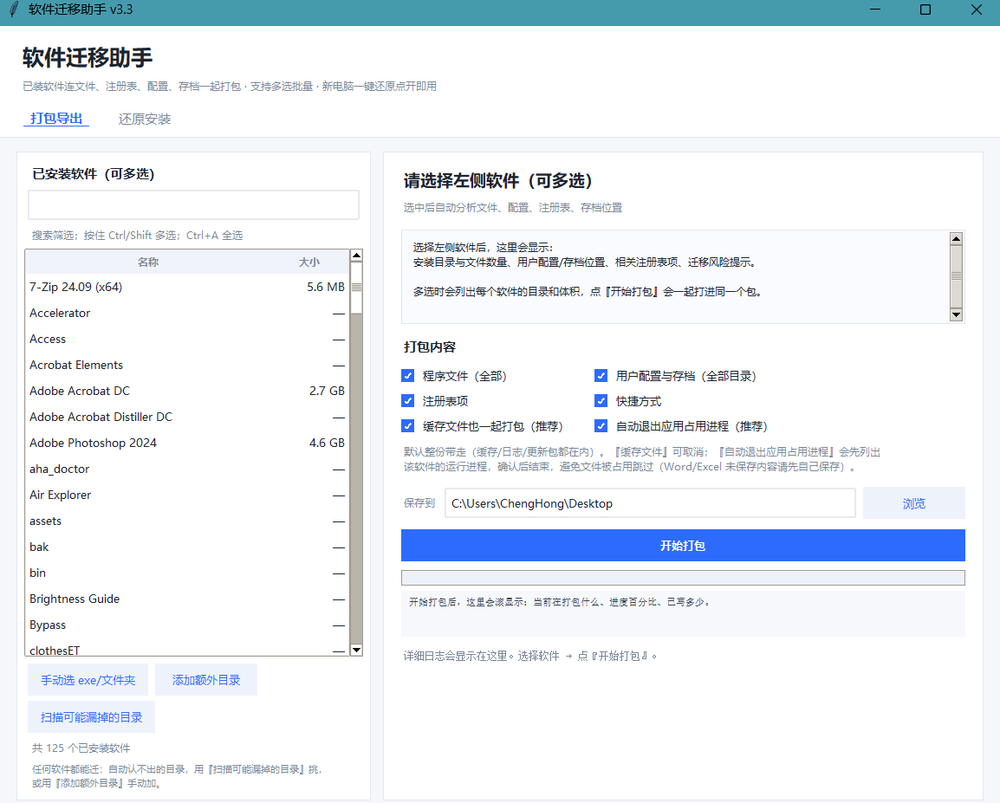

# 软件迁移助手 · Software Migration Assistant



> 把本机装好的**任意 Windows 软件**（程序文件 + 注册表 + 配置 + 缓存 + 存档 + 快捷方式）原样完整打包成一个 `.zip`，拷到新电脑一键还原，桌面自动出图标，双击即用。
>
> 界面截图：<https://aka.doubaocdn.com/s/QxiL3pN1Er>

**当前版本：v3.3** · 绿色单文件 · 约 10.2 MB · Windows 7 及以上 · **完全免费开源（MIT）**

---

## 一、怎么运行

**直接用 exe，双击即可，不需要安装 Python、不写系统目录。**

1. 下载 `软件迁移助手.exe`（本仓库根目录，或 [Releases](../../releases) 里的压缩包）。
2. **双击 `软件迁移助手.exe`** 就能打开，无需安装、无需配置、无需联网。
3. 若弹「Windows 已保护你的电脑」：点 **更多信息 → 仍要运行**。
4. 若杀软报未知程序：允许运行 / 添加信任即可（程序不联网、不上传任何数据）。
5. 装到 `C:\Program Files` 或要写 `HKLM` 注册表时，右键 **以管理员身份运行**。

用源码运行（仅开发调试时需要 Python 3.9+）：

```bash
python 软件迁移助手.py
```

自行重新构建 exe：

```bash
pip install pyinstaller
python -m PyInstaller --noconfirm --onefile --noconsole --name "软件迁移助手" 软件迁移助手.py
```

命令行自测（不开界面，跑完整打包 + 还原）：

```bash
软件迁移助手.exe --selftest "7-Zip" "PakePlus" D:\sm_test
```

---

## 二、完全免费开源

- **MIT License**，代码 100% 公开在本仓库（`软件迁移助手.py`，单文件、无第三方依赖）。
- 不收费、不弹广告、不联网校验、不上传任何本机数据；打包产物只写你指定的目录。
- 可自由使用、修改、二次分发（保留版权声明即可）。
- 只有标准库：`tkinter`（界面）、`winreg`（注册表）、`ctypes`（读 PE 版本资源）、`zipfile`/`hashlib`（打包与校验）、`subprocess`（调用系统 PowerShell 解析 `.lnk`）。

---

## 三、代码是怎么实现的

整个工具是**一个 `.py` 文件**（约 3900 行，Tkinter 单窗口 GUI），核心链路是「识别 → 收集 → 打包 → 还原 → 自检」。

### 1. 识别：不靠写死的软件名单，靠证据打分

`identity()` 汇总多源证据：卸载表里的显示名（去括号位数、去版本号）、发布商、注册表键叶（跳过 `{GUID}` 键）、卸载/图标 exe 名、安装目录夹名、目录内前 6 个 exe 名及其 **PE 版本资源**（用 `ctypes` 直接调 `version.dll` 读 `ProductName / FileDescription / InternalName / OriginalFilename / CompanyName`，不依赖任何三方库）。

`_name_score()` 把这些证据和候选目录名做相似度打分：完全一致 1.0、核心名一致 0.95、强名包含 0.78~0.86、单词重叠 0.80/0.74/0.70、弱词包含 0.74；阈值按场景分档（根目录 0.80、容器目录 0.90、盘符根 0.95）。所以中文名 ↔ 英文目录、厂商名 ↔ 产品名这种错位也能对上。

### 2. 安装目录：五种来源依次尝试，最后才是扫描

1. 卸载表 `InstallLocation` / `DisplayIcon` / `UninstallString`；
2. 注册表 `App Paths`（QQ、微信这类只在这里留真实路径）；
3. **开始菜单 / 桌面 `.lnk` 反查**：一次性解析四处快捷方式目录里所有 `.lnk` 的真实 `TargetPath`（走一次 PowerShell，结果缓存全程复用），按 lnk 名打分命中后取目标 exe 所在目录——装在 `D:\play\steam`、`C:\PDF\Acrobat DC` 这种自选位置也能找到；
4. 常见安装根（`Program Files`、`Program Files (x86)`、`ProgramW6432`、`LocalAppData\Programs`、用户目录）；
5. **每个磁盘根目录往下两层**打分扫描：`C:\Software\Weixin`、`D:\工具\xxx`、`E:\GreenApp` 这类「用户自己起的容器名」不需要预先知道叫什么。

排除项统一由 `_hard_bad()` 处理：MSI 缓存、`WindowsApps`、`$Recycle.Bin`、临时解包目录、GUID 目录、`SystemRoot`（`System32`/`SysWOW64` 里的同名 exe 不会被当成软件本体）。

### 3. 软件列表：四路来源合并

卸载注册表 4 处（HKLM/HKCU × 64/32 位）+ 开始菜单与桌面快捷方式递归解析 + `App Paths` + 安装根目录与各盘两层目录里的绿色软件（只看文件夹里真有主 exe 的，跳过卸载/帮助/更新/诊断类工具项）。驱动、运行库、系统组件单独标记为「组件」，误打包会提示。

### 4. 数据目录：名字 + 内容指纹 + 注册表路径值

- 扫描 `%APPDATA%` / `%LOCALAPPDATA%` / `LocalLow` / `%PROGRAMDATA%` / `文档`、`文档\My Games`、`Saved Games`、`公共文档`、`%PUBLIC%`、`桌面`、`%USERPROFILE%` 顶层（含 `.config`、`.local/share`）、`OneDrive\Documents`，以及发布商容器下的下一层。
- **内容指纹**：目录浅层 ≤2 层、≤256 KB 的文本配置里若写着「安装路径」或「主程序名」，即使名字对不上也认定（`_dir_mentions`）。
- **注册表路径值**：遍历软件注册表键 2 层取值，取指向 AppData / ProgramData / Documents / Saved Games 的目录路径（排除系统目录、安装目录本身、下载/桌面等无关目录）。
- 父子目录去重：收录父目录后自动丢弃其子路径，避免同一份数据打包两遍。
- 主程序名按体积过滤（≥512 KB 或名字 ≥14 字符才当线索），避免 `CrashDump.exe` 之类把崩溃转储目录误判成软件数据。

### 5. 打包：单包多软件、可中断、带校验

`make_package()` 用 `zipfile`（`ZIP_DEFLATED`，压缩级别 1，速度优先）写出包；包内 `manifest.json` 记录每个软件的程序目录、数据目录（`kind` + 原绝对路径 + 相对根目录路径 `rel`）、注册表导出、快捷方式、文件清单与 SHA-256。空目录也写一条目录记录，还原时按原样建出来。打包中途点『取消打包』会立刻停并删掉半截 `.zip`，不留坏包。

注册表导出用 `winreg` 递归读（含 `WOW6432Node`），非管理员时 `HKLM` 只读不写。

### 6. 还原：路径迁移 + 三项还原 + 自检

`import_package()` 逐项还原：程序文件、用户数据（按 `kind` 映射回新机的 `%APPDATA%` 等根目录，`sibling`/`registry`/`drive`/`manual` 以及**未知类型**一律按包里记录的原绝对路径放回原处）、注册表写回、快捷方式重建（目标失效时改指向新目录主程序）、桌面启动图标。安装位置留空=原路径，填父目录=统一搬过去并自动改名避让。

还原时做**旧路径 → 新路径**的全量替换（注册表字符串值 + `ini/json/xml/conf` 文本配置），每个文件按 SHA-256 校验，不一致会在日志点名（通常是被占用）。锁文件/被占用文件会判定为「跳过」而不是报错中断。

`selfcheck_restore()` 是 v3.1 起的还原后自检：逐项核对「应有 / 实到 / 缺失 / 跳过」，程序目录数文件（2 万上限、6 秒预算），再**试启动主程序 5 秒**（跑起来就自动关掉，返回 ok/warn/fail），最后在桌面生成 `迁移自检报告_YYYYmmdd_HHMMSS.txt`。

### 7. 界面与线程模型

单窗口 Tkinter，`打包导出` / `还原安装` 两页；所有耗时动作（分析、打包、还原、自检、进程扫描）都在后台线程跑，通过 `queue` 回到主线程刷进度和日志，界面不卡；「自动退出应用占用进程」只 `taskkill` 属于该软件目录的进程，`explorer`、`svchost` 等系统进程和 `C:\Windows` 下的进程永远不动。

---

## 四、使用说明（原文档）

> 以下内容与仓库内 `使用说明.md` 完全一致，未作改动。

# 软件迁移助手 · 使用说明（v2.9.2）

把本机装好的某个软件（程序文件 + 注册表 + 配置 + 缓存 + 存档 + 快捷方式）**原样完整**打包成一个 `.zip`，拷到新电脑还原，桌面自动出图标，双击即用。

---

## 一、新电脑没装 Python？——不需要装

`软件迁移助手.exe` 是绿色单文件，**双击即用，不依赖 Python、不安装、不写系统目录**。

1. 把 `软件迁移助手.exe` 和 `.zip` 迁移包一起拷到新电脑（放哪都行）。
2. 双击 `软件迁移助手.exe`。
3. 若弹「Windows 已保护你的电脑」：点 **更多信息 → 仍要运行**。
4. 若杀软报未知程序：允许运行 / 添加信任即可。

（只有拿的是 `.py` 源码时才需要 Python 3.9+。正常使用请直接用 exe。）

---

## 二、打包（源电脑）

1. 打开 exe，默认在「打包导出」页；左侧是本机已安装软件，搜索框可按名字筛选。
2. **支持多选**：按住 `Ctrl` 或 `Shift` 点选，`Ctrl+A` 全选；多选的软件会一起打进**同一个包**。
3. 选中后右侧自动分析，并逐条列出：
   - `[程序本体]` 安装目录、文件数、体积、主程序 exe；
   - `相关目录 N 处，合计 X（全部打包）`，每个目录都带 `里面是：…` 说明和是否属于缓存；
   - 注册表项、运行中提示、风险提示。
4. 列表里没有的软件：用 **手动选 exe/文件夹** 指定；还漏了旁系目录（比如 `C:\Users\你的用户名\xxx`）用 **添加额外目录** 补进来。
5. 勾选打包内容（默认全选）：程序文件 / 用户配置与存档 / 注册表项 / 快捷方式 / **缓存文件也一起打包** / **自动退出应用占用进程**。
   - **缓存文件这个勾选框默认是勾上的**，缓存、日志、更新包都跟着走，还原后与原机一模一样；
   - 只有你自己取消勾选，才会跳过 `Cache`、`Code Cache`、`Cache_Data`、`Logs`、`*.log` 这类纯缓存目录（体积更小，配置、登录状态、存档不受影响），包内说明会写明「本次已跳过（未打包缓存）」；
   - **自动退出应用占用进程**：勾着时，点『开始打包』会先列出该软件正在运行的进程（按 exe 实际路径判断，只认这个软件目录里的），确认后自动 `taskkill /T /F` 结束，日志会写「已结束进程：xxx.exe」，这样就不会出现「跳过 N 个被占用文件」；进程检测放在后台线程、多个软件只扫一次，确认框弹出和结束后界面都不会卡；
   - 选「否」= 保持运行，被占用文件跳过打包；系统进程（explorer、svchost 等）和 `C:\Windows` 目录下的进程永远不会被自动结束，避免误伤桌面；
6. 选保存位置 → **开始打包**。产物是一个 `.zip`。

**打包中可以取消**：开始打包后按钮会变成『取消打包』，点一下即可中止；当前文件写完就停（大文件最多几秒），已经写了一半的 `.zip` 会自动删掉，不会留下坏包。多点几个软件一起打包时也可以随时取消。

关掉要打包的软件再打包，能少几个「被占用跳过」的文件。

---

## 三、软件列表是从哪来的（为什么换台电脑也能认全）

列表不是只靠「卸载表」——很多绿色版、只有开始菜单项、便携版软件根本不写卸载项，所以合并了四路来源：

1. **卸载注册表 4 处**：`HKLM\…\Uninstall`、`HKLM\WOW6432Node\…\Uninstall`、`HKCU\…\Uninstall`、`HKCU\WOW6432Node\…\Uninstall`（32/64 位、管理员装的/当前用户装的都覆盖）；
2. **快捷方式**：递归解析 `ProgramData` / `AppData` 的开始菜单、`桌面`、`公共桌面` 里所有 `.lnk` 的真实目标 exe；
3. **注册表 `App Paths`**：`HKLM`(64) / `HKLM\WOW6432Node` / `HKCU`，补上卸载表没写全的程序路径；
4. **安装根目录 + 盘符扫描**：**每个盘符**下的 `Program Files`、`Program Files (x86)`、`Apps`、`AppData\Local\Programs`，以及**非系统盘根目录下一层**的文件夹（如 `D:\工具\xxx`、`E:\GreenApp`），识别解压即用的绿色软件（只看顶层有主 exe 的文件夹，跳过 `Windows`、`Common Files`、`Plug-ins` 插件目录、卸载/帮助/更新/诊断这类工具项）。

同一套软件可能出现多条入口（Office 的 Word/Excel/PowerPoint 指向同一目录、Git 有 Bash/CMD/GUI 三条），任选其中一条打包都会带走整个目录，内容一致，不会出错。

**驱动 / 运行库 / 系统组件**（Intel Chipset、.NET、VC++ 运行库、WebView2、Hotfix）会被识别成「组件」并在详情里写明：这类东西不属于可迁移的应用程序，新电脑直接装一次即可，不建议打包；误点打包时会弹提示，不会生成空包。

用户数据（按名称与发布商匹配，命中就纳入）：

- `%APPDATA%`（Roaming）、`%LOCALAPPDATA%`（Local）、`%LOCALAPPDATA%\Programs`、`%LOCALAPPDATA%\LocalLow`
- `%PROGRAMDATA%`，以及发布商目录下的再下一层
- `文档`、`文档\My Games`、`Saved Games`、`公共文档`、`桌面`
- `%USERPROFILE%` 顶层目录，以及顶层同名**单文件**配置（如 `.gitconfig`）
- 安装目录的**同级同名目录**
- 注册表各字符串值里写着的磁盘路径（且确认真实存在、不是临时目录、不是另一份程序副本）

---

## 四、每个目录「里面是什么」

不熟悉缓存目录的人常问「这个文件夹要不要带」。工具会逐个给中文说明，例如本机豆包实测：

| 目录 | 里面是什么 |
| --- | --- |
| `C:\xxx` | 程序本体（exe / dll / 资源），软件能不能打开全靠它 |
| `%APPDATA%\xxx` | 配置文件（json/ini/xml）：登录状态、界面设置、快捷键 |
| `%LOCALAPPDATA%\aha_doctor\xxx`（缓存） | 日志/临时文件，只是运行记录与崩溃转储，删了不影响使用 |
| `%LOCALAPPDATA%\xxx` | 浏览器内核（Chromium/CEF）数据目录：`Default` 里的 Local Storage / IndexedDB / Cookies 存着**登录状态、会话列表与聊天记录**，必须带走；同级 `cache`、`code cache` 等子目录是纯缓存 |
| `%LOCALAPPDATA%\xxxLinkRouter` | 程序组件 + 配置文件 |
| `C:\Users\xxx\xxx` | 会话/对话档案目录（chats、skills）：聊天历史、会话文件、技能配置 |

**缓存也照样打包**——只是标了「（缓存）」，还原后与原机完全一致。手工还原时这些缓存目录放不放都行，不影响软件打开。

**空文件夹也打包**：程序目录、用户数据目录、附加目录里那些没有文件的空子目录（`plugins\xxx\`、`logs\`、`profiles\空的配置` 等）都会在包里留一条目录记录，还原时按原样建出来，不会出现「原来有这个文件夹、还原后不见了」。

---

## 五、`.zip` 双击就能看说明

包根目录固定有三个东西：

```
安装说明.txt      ← 纯文本，记事本直接看
安装说明.html     ← 双击浏览器打开
manifest.json     ← 机器读的结构（别手动改）
app1\program\...      程序本体
app1\userdata\...     各用户目录（按 kind 分：roaming/local/locallow/programdata/documents/savedgames/sibling/registry）
app1\shortcuts\...    快捷方式 .lnk
app1\registry.json    注册表导出
```

---

## 六、还原（新电脑）

1. 切到「还原安装」→ **选择迁移包**，选 `.zip`（包里多个软件会一起还原，界面逐条列出原路径和「里面是」说明）。
2. 安装位置：
   - 留空 = 还原到每个软件原来的路径；
   - 填「统一父目录」= 装到该目录下各自子文件夹（如 `D:\Apps\xxx`），已存在会自动改名避让。
3. 勾选：还原程序文件 / 还原配置与存档 / 写入注册表 / 重建快捷方式 / 桌面生成启动图标（另有「便携模式」= 不写注册表）。
4. 点 **开始还原**。完成后桌面有图标，双击即用，登录状态与历史都在。还原进度同样最多 99%，日志写「还原完成」才到 100%。
5. 装到 `C:\Program Files` 或要写 HKLM 时，右键 **以管理员身份运行**（否则 HKLM 会跳过并提示）。

还原细节：旧路径→新路径的全量替换（注册表值 + ini/json/xml 文本配置）；快捷方式目标失效时改指向新目录主程序；每个文件带 SHA-256，校验不一致会在日志点名（通常是被占用）。

---

## 七、做不到的部分

- **驱动、系统服务、内核组件**（杀毒、虚拟网卡、输入法、VPN 驱动）：搬不了，新电脑重装。
- **联网激活 / 硬件绑定**的授权软件：文件能搬，授权要重新登录激活。
- **运行库**（VC++ / .NET / DirectX）：包里附源电脑运行库清单，缺就装，否则提示缺 DLL。
- 32 位可搬到 64 位系统；反过来不行。
- 打包时软件正在运行，被占用文件会跳过（日志写明「跳过 N 个」）。

---

## 八、文件清单

| 文件 | 说明 |
| --- | --- |
| `软件迁移助手.exe` | 绿色单文件（约 10.2 MB），双击即用，无需 Python |
| `软件迁移助手.py` | 源码，便于改逻辑或自行打包 |
| `使用说明.md` | 本文件 |

重新构建 exe（需要本机 Python）：

```
python -m PyInstaller --noconfirm --onefile --noconsole --name "软件迁移助手" 软件迁移助手.py
```

命令行自测（不开界面，跑完整打包+还原）：

```
软件迁移助手.exe --selftest "7-Zip" "PakePlus" D:\sm_test
```

---

## 五、版本记录

| 版本 | 主要变化 |
| --- | --- |
| v3.3 | 安装目录定位改为通用策略（快捷方式反查 + 各盘两层扫描，去掉写死目录名）；数据目录新增 `.config`、`.local/share`、`%PUBLIC%`；未知目录类型按原路径还原 |
| v3.2 | 删除写死的软件名对照表，改为内容指纹 + 注册表路径值 + 主程序体积过滤三条通用规则；父子目录去重 |
| v3.1 | 还原后自检（逐项核对 + 试启动 5 秒 + 生成自检报告） |
| v3.0 | 重写身份识别引擎（PE 版本资源 + 相似度打分），支持任意软件 |

## 六、许可证

[MIT License](LICENSE) © 2026 DLXH-item
